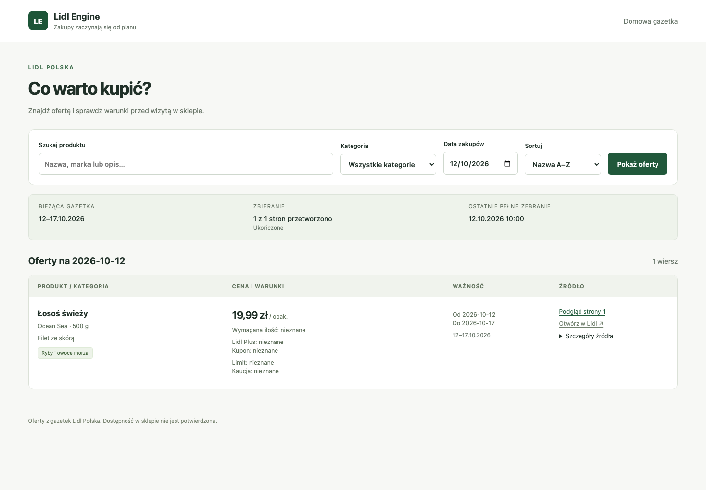

# PER-25 local verification

Date: 2026-10-12. Environment: macOS ARM64 development host, Linux application container, PostgreSQL 17 and Chromium. External Lidl and OpenRouter inference responses were fixtures; no paid inference requests ran.

## Results

| Check | Result |
| --- | --- |
| Full pytest suite with real PostgreSQL and Chromium | 51 passed in 7.73 seconds |
| Ruff lint | Passed |
| Ruff formatting | Passed |
| mypy | Passed, 12 source files |
| Versioned migrations | Applied to isolated workflow schemas and the container verification database |
| Compose configuration with example environment | Passed |
| Production Docker image | Built with locked dependencies |
| PostgreSQL plus retained-image backup/restore | Passed in the isolated test deployment |
| Gunicorn after restoration and process restart | Rendered the retained Polish offer; health returned `ok` |
| Standards review | Two maintainability findings resolved; no remaining actionable findings |
| Spec review | Missing-page support, superseded display facts, commercial small print and mixed-batch recovery findings resolved; no remaining actionable findings |

The workflow checks cover first-Gazetka selection, unchanged-content reuse, changed descriptions/models/images, year-crossing dates, unknown bounds, category filtering, prices and conditions, source reconciliation, conflict-context adjacency, failed and successful rereads, missing metadata pages, bounded retries, authentication recovery, interruption, overlap prevention, retention and 1,000 rendered rows. The desktop check covers HTMX updates, URL navigation, browser history and source previews loaded on demand.

## Desktop fixture

The screenshot shows the one-offer collection-to-browser fixture. It demonstrates the rendered interface, not measured extraction accuracy.

## Pending launch checks

The original-image evaluation across at least 100 eligible offers, household-network performance on the Ubuntu deployment, actual weekly provider spending and hosted GitHub Actions execution remain unmeasured. See [the launch guide](launch.md) for reproducible checks. Ubuntu access and approved OpenRouter models have been requested from the owner.
